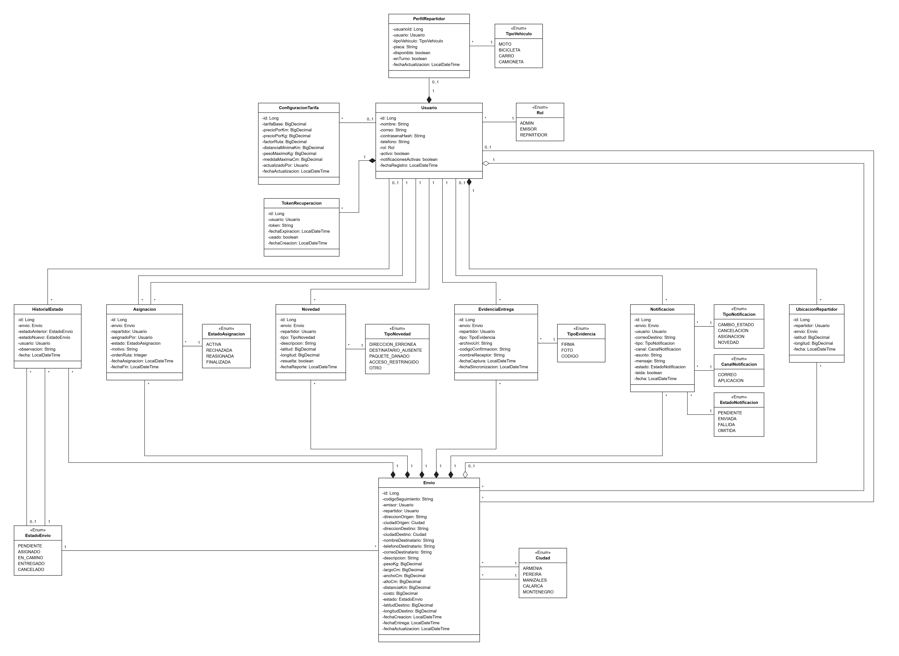
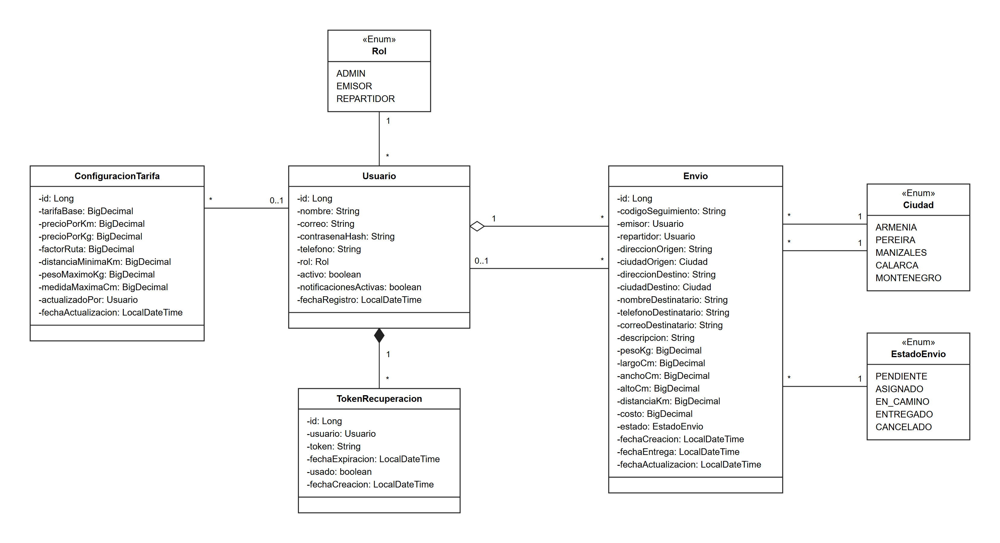
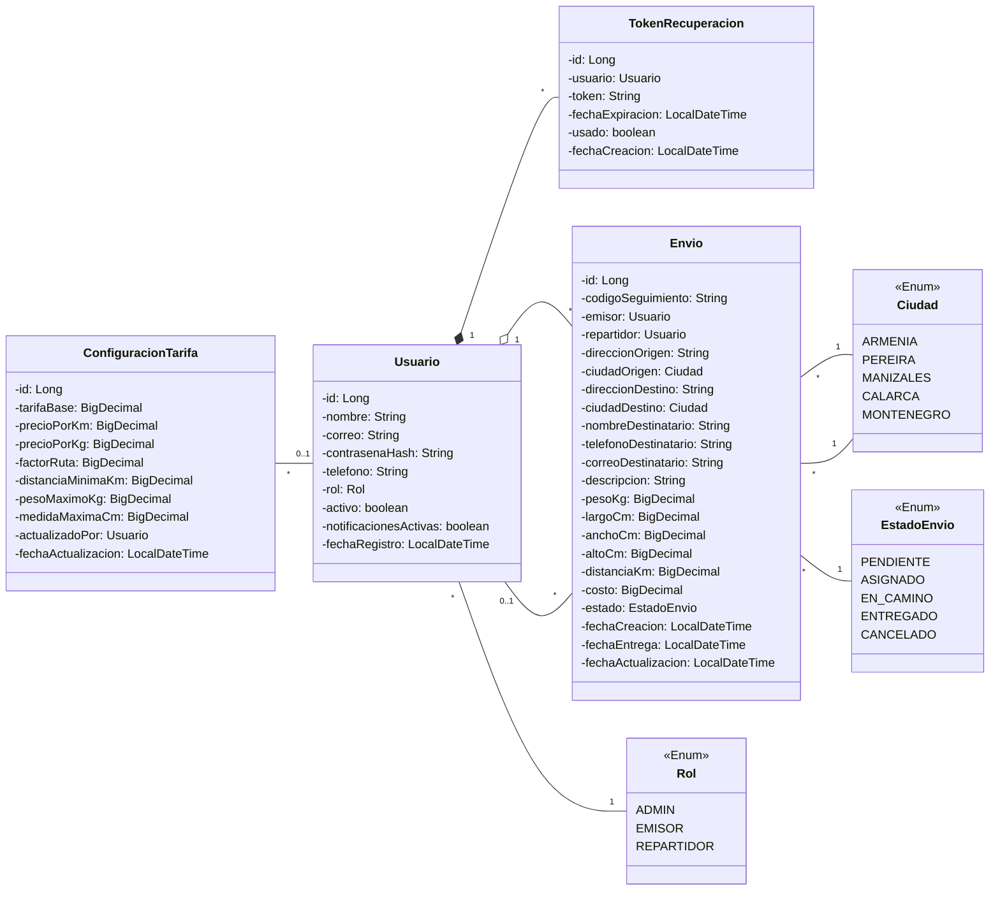

# Modelo de datos — Diagrama de clases UML

Este documento describe el modelo de dominio completo de UQDelivery (todos los sprints) en notación de
diagrama de clases UML. Cada clase es una entidad JPA (una tabla de la base de datos) o un enum.

Las imágenes (esta y la del Sprint 1, más abajo) son la versión para presentar. Los bloques Mermaid de abajo son la versión editable:
GitHub, IntelliJ y VS Code (con la extensión *Markdown Preview Mermaid Support*) los dibujan
automáticamente, y se pueden editar en vivo en <https://mermaid.live>. Si cambia el modelo, se actualizan
los dos.

Por ahora el diagrama **no muestra métodos**: los métodos de dominio de cada entidad están descritos en la
sección 4.5 de `CLAUDE.md` y se agregarán aquí cuando estén implementados.

## Cómo leer el diagrama

| Elemento | Significa |
|---|---|
| `-nombre: String` | Atributo privado `nombre` de tipo `String` (en las entidades todos son privados) |
| `«Enum»` | Enum de Java: lista fija de valores (tipos, estados, ciudades) |
| Línea simple | **Asociación**: una clase tiene un atributo del tipo de la otra (referencias y enums) |
| Línea con rombo negro ◆ | **Composición**: la parte no existe sin el todo (el rombo va del lado del todo). Ej.: un `HistorialEstado` no existe sin su `Envio` |
| Línea con rombo blanco ◇ | **Agregación**: la parte pertenece al todo pero tiene vida propia. Ej.: un `Envio` y su emisor |
| `1` | Exactamente uno |
| `0..1` | Opcional: cero o uno (el atributo puede ser `null`) |
| `*` | Cero o muchos |

Ejemplo: la línea con rombo blanco entre `Usuario` y `Envio`, con `1` del lado de `Usuario` y `*` del lado
de `Envio`, se lee "un usuario emite muchos envíos, y cada envío tiene exactamente un emisor". Qué atributo
representa cada línea se ve dentro de la clase que guarda la referencia: `-emisor: Usuario` en `Envio`.

Las líneas no llevan flecha ni texto en el medio. En el código todas las referencias van en un solo sentido
(la clase que tiene el atributo conoce a la otra, no al revés).

Hay dos tipos de clases:

- **Entidades (11):** clases con `@Entity`. Cada una es una tabla de la base de datos.
- **Enums (10):** tipos, estados y listas fijas. En el código son `enum` y la columna guarda el nombre del
  valor con `@Enumerated(EnumType.STRING)`. **No son tablas en la base de datos.**

## Diagrama del Sprint 1

Solo lo que se implementa en HU-00 a HU-05: 4 entidades y 3 enums.

## Diagrama completo (todos los sprints)

```mermaid
classDiagram
    direction LR

    %% ---------- Entidades ----------
    class Usuario {
        -id: Long
        -nombre: String
        -correo: String
        -contrasenaHash: String
        -telefono: String
        -rol: Rol
        -activo: boolean
        -notificacionesActivas: boolean
        -fechaRegistro: LocalDateTime
    }
    class PerfilRepartidor {
        -usuarioId: Long
        -usuario: Usuario
        -tipoVehiculo: TipoVehiculo
        -placa: String
        -disponible: boolean
        -enTurno: boolean
        -fechaActualizacion: LocalDateTime
    }
    class TokenRecuperacion {
        -id: Long
        -usuario: Usuario
        -token: String
        -fechaExpiracion: LocalDateTime
        -usado: boolean
        -fechaCreacion: LocalDateTime
    }
    class ConfiguracionTarifa {
        -id: Long
        -tarifaBase: BigDecimal
        -precioPorKm: BigDecimal
        -precioPorKg: BigDecimal
        -factorRuta: BigDecimal
        -distanciaMinimaKm: BigDecimal
        -pesoMaximoKg: BigDecimal
        -medidaMaximaCm: BigDecimal
        -actualizadoPor: Usuario
        -fechaActualizacion: LocalDateTime
    }
    class Envio {
        -id: Long
        -codigoSeguimiento: String
        -emisor: Usuario
        -repartidor: Usuario
        -direccionOrigen: String
        -ciudadOrigen: Ciudad
        -direccionDestino: String
        -ciudadDestino: Ciudad
        -nombreDestinatario: String
        -telefonoDestinatario: String
        -correoDestinatario: String
        -descripcion: String
        -pesoKg: BigDecimal
        -largoCm: BigDecimal
        -anchoCm: BigDecimal
        -altoCm: BigDecimal
        -distanciaKm: BigDecimal
        -costo: BigDecimal
        -estado: EstadoEnvio
        -latitudDestino: BigDecimal
        -longitudDestino: BigDecimal
        -fechaCreacion: LocalDateTime
        -fechaEntrega: LocalDateTime
        -fechaActualizacion: LocalDateTime
    }
    class HistorialEstado {
        -id: Long
        -envio: Envio
        -estadoAnterior: EstadoEnvio
        -estadoNuevo: EstadoEnvio
        -usuario: Usuario
        -observacion: String
        -fecha: LocalDateTime
    }
    class Asignacion {
        -id: Long
        -envio: Envio
        -repartidor: Usuario
        -asignadoPor: Usuario
        -estado: EstadoAsignacion
        -motivo: String
        -ordenRuta: Integer
        -fechaAsignacion: LocalDateTime
        -fechaFin: LocalDateTime
    }
    class Novedad {
        -id: Long
        -envio: Envio
        -repartidor: Usuario
        -tipo: TipoNovedad
        -descripcion: String
        -latitud: BigDecimal
        -longitud: BigDecimal
        -resuelta: boolean
        -fechaReporte: LocalDateTime
    }
    class EvidenciaEntrega {
        -id: Long
        -envio: Envio
        -repartidor: Usuario
        -tipo: TipoEvidencia
        -archivoUrl: String
        -codigoConfirmacion: String
        -nombreReceptor: String
        -fechaCaptura: LocalDateTime
        -fechaSincronizacion: LocalDateTime
    }
    class Notificacion {
        -id: Long
        -envio: Envio
        -usuario: Usuario
        -correoDestino: String
        -tipo: TipoNotificacion
        -canal: CanalNotificacion
        -asunto: String
        -mensaje: String
        -estado: EstadoNotificacion
        -leida: boolean
        -fecha: LocalDateTime
    }
    class UbicacionRepartidor {
        -id: Long
        -repartidor: Usuario
        -envio: Envio
        -latitud: BigDecimal
        -longitud: BigDecimal
        -fecha: LocalDateTime
    }

    %% ---------- Enums ----------
    class Rol {
        <<Enum>>
        ADMIN
        EMISOR
        REPARTIDOR
    }
    class Ciudad {
        <<Enum>>
        ARMENIA
        PEREIRA
        MANIZALES
        CALARCA
        MONTENEGRO
    }
    class EstadoEnvio {
        <<Enum>>
        PENDIENTE
        ASIGNADO
        EN_CAMINO
        ENTREGADO
        CANCELADO
    }
    class TipoVehiculo {
        <<Enum>>
        MOTO
        BICICLETA
        CARRO
        CAMIONETA
    }
    class EstadoAsignacion {
        <<Enum>>
        ACTIVA
        RECHAZADA
        REASIGNADA
        FINALIZADA
    }
    class TipoNovedad {
        <<Enum>>
        DIRECCION_ERRONEA
        DESTINATARIO_AUSENTE
        PAQUETE_DANADO
        ACCESO_RESTRINGIDO
        OTRO
    }
    class TipoEvidencia {
        <<Enum>>
        FIRMA
        FOTO
        CODIGO
    }
    class TipoNotificacion {
        <<Enum>>
        CAMBIO_ESTADO
        CANCELACION
        ASIGNACION
        NOVEDAD
    }
    class CanalNotificacion {
        <<Enum>>
        CORREO
        APLICACION
    }
    class EstadoNotificacion {
        <<Enum>>
        PENDIENTE
        ENVIADA
        FALLIDA
        OMITIDA
    }

    %% ---------- Composiciones (rombo negro del lado del todo) ----------
    Usuario "1" *-- "0..1" PerfilRepartidor
    Usuario "1" *-- "*" TokenRecuperacion
    Usuario "1" *-- "*" UbicacionRepartidor
    Envio "1" *-- "*" HistorialEstado
    Envio "1" *-- "*" Asignacion
    Envio "1" *-- "*" Novedad
    Envio "1" *-- "*" EvidenciaEntrega
    Envio "1" *-- "*" Notificacion

    %% ---------- Agregaciones (rombo blanco del lado del todo) ----------
    Usuario "1" o-- "*" Envio
    Envio "0..1" o-- "*" UbicacionRepartidor

    %% ---------- Asociaciones entre clases ----------
    Envio "*" -- "0..1" Usuario
    ConfiguracionTarifa "*" -- "0..1" Usuario
    HistorialEstado "*" -- "0..1" Usuario
    Asignacion "*" -- "1" Usuario
    Asignacion "*" -- "1" Usuario
    Novedad "*" -- "1" Usuario
    EvidenciaEntrega "*" -- "1" Usuario
    Notificacion "*" -- "0..1" Usuario

    %% ---------- Asociaciones con enums ----------
    Usuario "*" -- "1" Rol
    PerfilRepartidor "*" -- "1" TipoVehiculo
    Envio "*" -- "1" Ciudad
    Envio "*" -- "1" Ciudad
    Envio "*" -- "1" EstadoEnvio
    HistorialEstado "*" -- "0..1" EstadoEnvio
    HistorialEstado "*" -- "1" EstadoEnvio
    Asignacion "*" -- "1" EstadoAsignacion
    Novedad "*" -- "1" TipoNovedad
    EvidenciaEntrega "*" -- "1" TipoEvidencia
    Notificacion "*" -- "1" TipoNotificacion
    Notificacion "*" -- "1" CanalNotificacion
    Notificacion "*" -- "1" EstadoNotificacion
```

### Tipo de cada relación

| Relación | Tipo | Multiplicidad | Atributo | Por qué |
|---|---|---|---|---|
| `Usuario` – `PerfilRepartidor` | Composición | `1` – `0..1` | `PerfilRepartidor.usuario` | El perfil solo existe para un usuario |
| `Usuario` – `TokenRecuperacion` | Composición | `1` – `*` | `TokenRecuperacion.usuario` | El token no sirve sin su usuario |
| `Usuario` – `UbicacionRepartidor` | Composición | `1` – `*` | `UbicacionRepartidor.repartidor` | Las posiciones son del repartidor |
| `Envio` – `HistorialEstado` | Composición | `1` – `*` | `HistorialEstado.envio` | El historial es parte del envío |
| `Envio` – `Asignacion` | Composición | `1` – `*` | `Asignacion.envio` | La asignación es parte del envío |
| `Envio` – `Novedad` | Composición | `1` – `*` | `Novedad.envio` | La novedad ocurre en un envío |
| `Envio` – `EvidenciaEntrega` | Composición | `1` – `*` | `EvidenciaEntrega.envio` | La evidencia es de un envío |
| `Envio` – `Notificacion` | Composición | `1` – `*` | `Notificacion.envio` | La notificación avisa sobre un envío |
| `Usuario` – `Envio` | Agregación | `1` – `*` | `Envio.emisor` | El emisor agrupa sus envíos, pero el envío es un registro propio |
| `Envio` – `UbicacionRepartidor` | Agregación | `0..1` – `*` | `UbicacionRepartidor.envio` | La posición puede no estar ligada a un envío |
| `Envio` – `Usuario` | Asociación | `*` – `0..1` | `Envio.repartidor` | Repartidor actual |
| `ConfiguracionTarifa` – `Usuario` | Asociación | `*` – `0..1` | `actualizadoPor` | Quién cambió las tarifas |
| `HistorialEstado` – `Usuario` | Asociación | `*` – `0..1` | `usuario` | Quién cambió el estado |
| `Asignacion` – `Usuario` (dos líneas) | Asociación | `*` – `1` | `repartidor` y `asignadoPor` | Repartidor asignado y admin que asignó |
| `Novedad` – `Usuario` | Asociación | `*` – `1` | `repartidor` | Quién reporta |
| `EvidenciaEntrega` – `Usuario` | Asociación | `*` – `1` | `repartidor` | Quién entrega |
| `Notificacion` – `Usuario` | Asociación | `*` – `0..1` | `usuario` | Destinatario con cuenta (el receptor final no tiene) |
| Entidad – enum | Asociación | `*` – `1` | `rol`, `estado`, `tipo`... | Valor de una lista fija |

Cuando hay dos líneas entre las mismas clases, el atributo dice cuál es cuál: `Envio` – `Ciudad`
(`ciudadOrigen` y `ciudadDestino`) y `HistorialEstado` – `EstadoEnvio` (`estadoAnterior`, `0..1`, vacío en el
primer registro; y `estadoNuevo`, `1`).

## Clases y tablas

### Entidades

| Clase | Tabla | Para qué | Sprint |
|---|---|---|---|
| `Usuario` | `usuarios` | Cuentas de admin, emisores y repartidores | 1 |
| `TokenRecuperacion` | `tokens_recuperacion` | Enlaces de recuperación de contraseña (30 min, un solo uso) | 1 |
| `ConfiguracionTarifa` | `configuracion_tarifa` | Tarifas y límites del paquete. Una sola fila (`id = 1`) | 1 |
| `Envio` | `envios` | Solicitudes de envío con su costo y estado | 1 |
| `PerfilRepartidor` | `perfil_repartidor` | Vehículo, placa y disponibilidad. Solo existe para usuarios repartidores | 2 |
| `Asignacion` | `asignaciones` | Historial de asignaciones y reasignaciones de repartidores | 2 |
| `HistorialEstado` | `historial_estados` | Cada cambio de estado de un envío, con quién y cuándo | 2 |
| `Novedad` | `novedades` | Imprevistos reportados en ruta (dirección errónea, cliente ausente...) | 2 |
| `EvidenciaEntrega` | `evidencias_entrega` | Firma, foto o código de confirmación al entregar | 2 |
| `Notificacion` | `notificaciones` | Correos y alertas enviados por cambios de estado o cancelaciones | 2 |
| `UbicacionRepartidor` | `ubicaciones_repartidor` | Posiciones del repartidor para el rastreo | 3 |

En la base de datos los atributos se escriben en `snake_case` (`contrasenaHash` → `contrasena_hash`) y las
asociaciones se guardan como llave foránea con sufijo `_id` (`emisor` → `emisor_id`).

### Enums

| Enum | Atributos que lo usan | Valores | Sprint |
|---|---|---|---|
| `Rol` | `Usuario.rol` | `ADMIN`, `EMISOR`, `REPARTIDOR` | 1 |
| `Ciudad` | `Envio.ciudadOrigen`, `Envio.ciudadDestino` | `ARMENIA`, `PEREIRA`, `MANIZALES`, `CALARCA`, `MONTENEGRO` (cada una con nombre, latitud y longitud) | 1 |
| `EstadoEnvio` | `Envio.estado`, `HistorialEstado.estadoAnterior`, `HistorialEstado.estadoNuevo` | `PENDIENTE`, `ASIGNADO`, `EN_CAMINO`, `ENTREGADO`, `CANCELADO` | 1 |
| `TipoVehiculo` | `PerfilRepartidor.tipoVehiculo` | `MOTO`, `BICICLETA`, `CARRO`, `CAMIONETA` | 2 |
| `EstadoAsignacion` | `Asignacion.estado` | `ACTIVA`, `RECHAZADA`, `REASIGNADA`, `FINALIZADA` | 2 |
| `TipoNovedad` | `Novedad.tipo` | `DIRECCION_ERRONEA`, `DESTINATARIO_AUSENTE`, `PAQUETE_DANADO`, `ACCESO_RESTRINGIDO`, `OTRO` | 2 |
| `TipoEvidencia` | `EvidenciaEntrega.tipo` | `FIRMA`, `FOTO`, `CODIGO` | 2 |
| `TipoNotificacion` | `Notificacion.tipo` | `CAMBIO_ESTADO`, `CANCELACION`, `ASIGNACION`, `NOVEDAD` | 2 |
| `CanalNotificacion` | `Notificacion.canal` | `CORREO`, `APLICACION` | 2 |
| `EstadoNotificacion` | `Notificacion.estado` | `PENDIENTE`, `ENVIADA`, `FALLIDA`, `OMITIDA` | 2 |

## Decisiones de diseño

- **No hay asociaciones muchos a muchos directas.** Las que existen en el negocio se resuelven con una clase
  intermedia que además guarda datos propios:
  - Envíos ↔ repartidores (un envío puede reasignarse) → `Asignacion`.
  - Envíos ↔ estados (un envío pasa por varios estados) → `HistorialEstado`.
  - Envíos ↔ repartidores en el rastreo → `UbicacionRepartidor`.
- **Referencias en un solo sentido.** La clase que tiene el atributo conoce a la otra
  (`Envio` conoce a su `emisor`, pero `Usuario` no tiene una lista de envíos). En JPA son `@ManyToOne` con
  `fetch = FetchType.LAZY`; las consultas en sentido contrario se hacen con el repository. La composición
  no implica borrado en cascada: en este proyecto no se borran envíos ni usuarios.
- **`Envio.repartidor` repite a propósito el repartidor actual** que también está en `Asignacion`, para
  consultarlo sin recorrer el historial. En HU-06, asignar o reasignar actualiza los dos en la misma operación.
- **`Envio` tiene dos asociaciones a `Usuario`** (`emisor` obligatoria y `repartidor` opcional) y **dos a
  `Ciudad`** (origen y destino). Son asociaciones distintas, no una muchos a muchos.
- **`PerfilRepartidor` comparte la llave de `Usuario`** (`@OneToOne` con `@MapsId`): un usuario tiene como
  máximo un perfil de repartidor.
- **`costo` y `distanciaKm` se guardan en el envío** y no se recalculan: si cambian las tarifas, los envíos
  anteriores conservan su precio.
- **La distancia se calcula entre ciudades** (Haversine × `factorRuta`), por eso `Ciudad` guarda latitud y
  longitud. Las coordenadas exactas del destino (`latitudDestino`, `longitudDestino`) llegan en el Sprint 3
  con la API de mapas.
- **Dinero y medidas en `BigDecimal`** (columna `numeric`), nunca en `double`.
- **Las entidades no tienen setters**: sus datos cambian solo a través de métodos de dominio.
