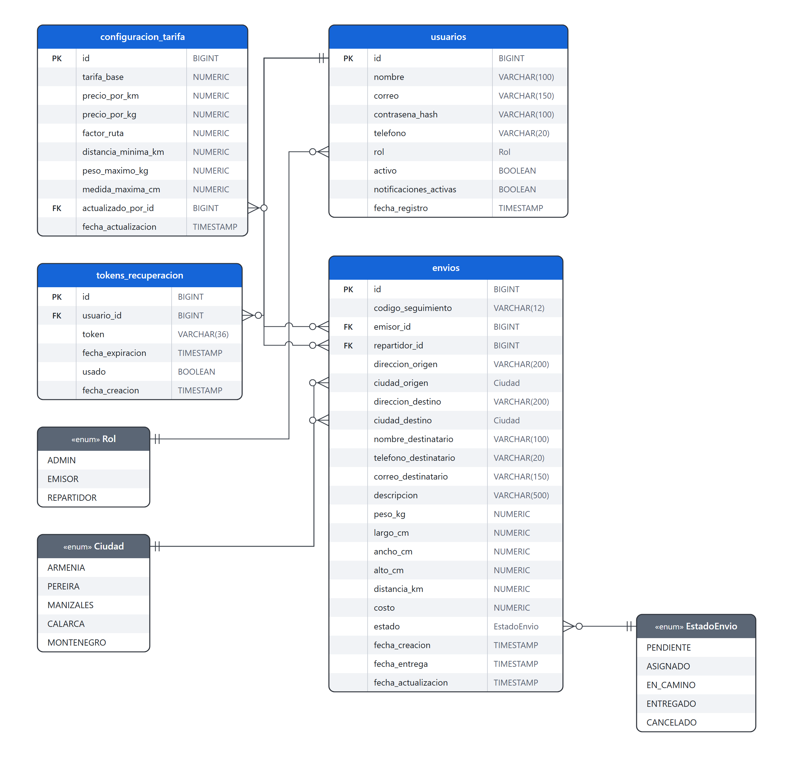
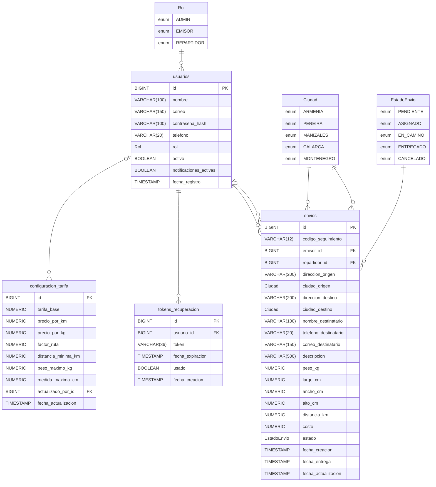
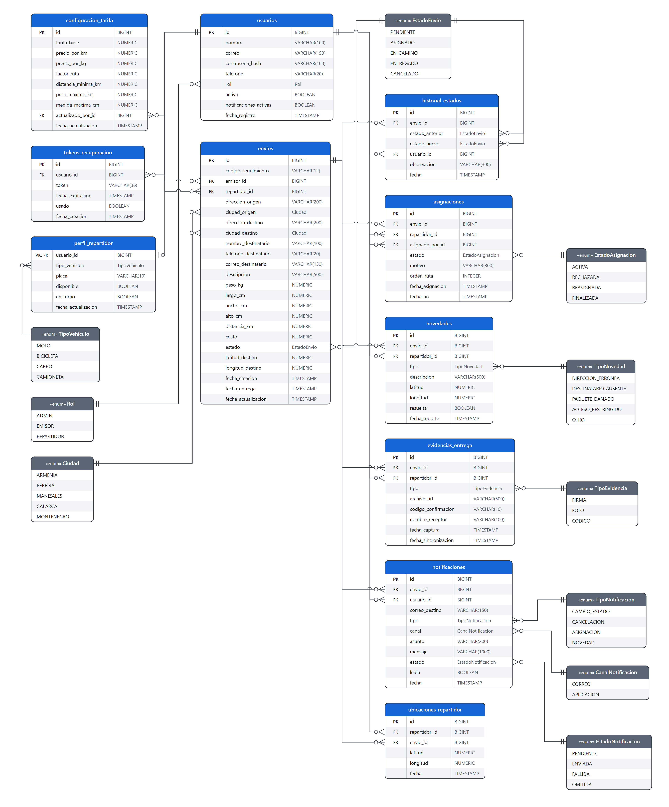

# Modelo de datos

Diagrama entidad-relación de la base de datos, en notación pata de gallo. Cada tabla muestra clave (PK/FK),
columna y tipo; las cajas grises son enums (se guardan como texto, no son tablas). Los PNG y el Mermaid se
generan con `node docs/modelo-datos/generar-diagramas.js` (ver `CLAUDE.md` 4.4).

## Sprint 1

## Completo (todos los sprints)

```mermaid
erDiagram
    configuracion_tarifa {
        BIGINT id PK
        NUMERIC tarifa_base
        NUMERIC precio_por_km
        NUMERIC precio_por_kg
        NUMERIC factor_ruta
        NUMERIC distancia_minima_km
        NUMERIC peso_maximo_kg
        NUMERIC medida_maxima_cm
        BIGINT actualizado_por_id FK
        TIMESTAMP fecha_actualizacion
    }
    tokens_recuperacion {
        BIGINT id PK
        BIGINT usuario_id FK
        VARCHAR(36) token
        TIMESTAMP fecha_expiracion
        BOOLEAN usado
        TIMESTAMP fecha_creacion
    }
    perfil_repartidor {
        BIGINT usuario_id PK, FK
        TipoVehiculo tipo_vehiculo
        VARCHAR(10) placa
        BOOLEAN disponible
        BOOLEAN en_turno
        TIMESTAMP fecha_actualizacion
    }
    usuarios {
        BIGINT id PK
        VARCHAR(100) nombre
        VARCHAR(150) correo
        VARCHAR(100) contrasena_hash
        VARCHAR(20) telefono
        Rol rol
        BOOLEAN activo
        BOOLEAN notificaciones_activas
        TIMESTAMP fecha_registro
    }
    envios {
        BIGINT id PK
        VARCHAR(12) codigo_seguimiento
        BIGINT emisor_id FK
        BIGINT repartidor_id FK
        VARCHAR(200) direccion_origen
        Ciudad ciudad_origen
        VARCHAR(200) direccion_destino
        Ciudad ciudad_destino
        VARCHAR(100) nombre_destinatario
        VARCHAR(20) telefono_destinatario
        VARCHAR(150) correo_destinatario
        VARCHAR(500) descripcion
        NUMERIC peso_kg
        NUMERIC largo_cm
        NUMERIC ancho_cm
        NUMERIC alto_cm
        NUMERIC distancia_km
        NUMERIC costo
        EstadoEnvio estado
        NUMERIC latitud_destino
        NUMERIC longitud_destino
        TIMESTAMP fecha_creacion
        TIMESTAMP fecha_entrega
        TIMESTAMP fecha_actualizacion
    }
    historial_estados {
        BIGINT id PK
        BIGINT envio_id FK
        EstadoEnvio estado_anterior
        EstadoEnvio estado_nuevo
        BIGINT usuario_id FK
        VARCHAR(300) observacion
        TIMESTAMP fecha
    }
    asignaciones {
        BIGINT id PK
        BIGINT envio_id FK
        BIGINT repartidor_id FK
        BIGINT asignado_por_id FK
        EstadoAsignacion estado
        VARCHAR(300) motivo
        INTEGER orden_ruta
        TIMESTAMP fecha_asignacion
        TIMESTAMP fecha_fin
    }
    novedades {
        BIGINT id PK
        BIGINT envio_id FK
        BIGINT repartidor_id FK
        TipoNovedad tipo
        VARCHAR(500) descripcion
        NUMERIC latitud
        NUMERIC longitud
        BOOLEAN resuelta
        TIMESTAMP fecha_reporte
    }
    evidencias_entrega {
        BIGINT id PK
        BIGINT envio_id FK
        BIGINT repartidor_id FK
        TipoEvidencia tipo
        VARCHAR(500) archivo_url
        VARCHAR(10) codigo_confirmacion
        VARCHAR(100) nombre_receptor
        TIMESTAMP fecha_captura
        TIMESTAMP fecha_sincronizacion
    }
    notificaciones {
        BIGINT id PK
        BIGINT envio_id FK
        BIGINT usuario_id FK
        VARCHAR(150) correo_destino
        TipoNotificacion tipo
        CanalNotificacion canal
        VARCHAR(200) asunto
        VARCHAR(1000) mensaje
        EstadoNotificacion estado
        BOOLEAN leida
        TIMESTAMP fecha
    }
    ubicaciones_repartidor {
        BIGINT id PK
        BIGINT repartidor_id FK
        BIGINT envio_id FK
        NUMERIC latitud
        NUMERIC longitud
        TIMESTAMP fecha
    }
    TipoVehiculo {
        enum MOTO
        enum BICICLETA
        enum CARRO
        enum CAMIONETA
    }
    Rol {
        enum ADMIN
        enum EMISOR
        enum REPARTIDOR
    }
    Ciudad {
        enum ARMENIA
        enum PEREIRA
        enum MANIZALES
        enum CALARCA
        enum MONTENEGRO
    }
    EstadoEnvio {
        enum PENDIENTE
        enum ASIGNADO
        enum EN_CAMINO
        enum ENTREGADO
        enum CANCELADO
    }
    EstadoAsignacion {
        enum ACTIVA
        enum RECHAZADA
        enum REASIGNADA
        enum FINALIZADA
    }
    TipoNovedad {
        enum DIRECCION_ERRONEA
        enum DESTINATARIO_AUSENTE
        enum PAQUETE_DANADO
        enum ACCESO_RESTRINGIDO
        enum OTRO
    }
    TipoEvidencia {
        enum FIRMA
        enum FOTO
        enum CODIGO
    }
    TipoNotificacion {
        enum CAMBIO_ESTADO
        enum CANCELACION
        enum ASIGNACION
        enum NOVEDAD
    }
    CanalNotificacion {
        enum CORREO
        enum APLICACION
    }
    EstadoNotificacion {
        enum PENDIENTE
        enum ENVIADA
        enum FALLIDA
        enum OMITIDA
    }

    usuarios |o--o{ configuracion_tarifa : ""
    usuarios ||--o{ tokens_recuperacion : ""
    usuarios ||--o| perfil_repartidor : ""
    usuarios ||--o{ envios : ""
    usuarios |o--o{ envios : ""
    Rol ||--o{ usuarios : ""
    Ciudad ||--o{ envios : ""
    Ciudad ||--o{ envios : ""
    TipoVehiculo ||--o{ perfil_repartidor : ""
    envios ||--o{ historial_estados : ""
    envios ||--o{ asignaciones : ""
    envios ||--o{ novedades : ""
    envios ||--o{ evidencias_entrega : ""
    envios ||--o{ notificaciones : ""
    envios |o--o{ ubicaciones_repartidor : ""
    EstadoEnvio ||--o{ envios : ""
    usuarios |o--o{ historial_estados : ""
    usuarios ||--o{ asignaciones : ""
    usuarios ||--o{ asignaciones : ""
    usuarios ||--o{ novedades : ""
    usuarios ||--o{ evidencias_entrega : ""
    usuarios |o--o{ notificaciones : ""
    usuarios ||--o{ ubicaciones_repartidor : ""
    EstadoEnvio |o--o{ historial_estados : ""
    EstadoEnvio ||--o{ historial_estados : ""
    EstadoAsignacion ||--o{ asignaciones : ""
    TipoNovedad ||--o{ novedades : ""
    TipoEvidencia ||--o{ evidencias_entrega : ""
    TipoNotificacion ||--o{ notificaciones : ""
    CanalNotificacion ||--o{ notificaciones : ""
    EstadoNotificacion ||--o{ notificaciones : ""
```

